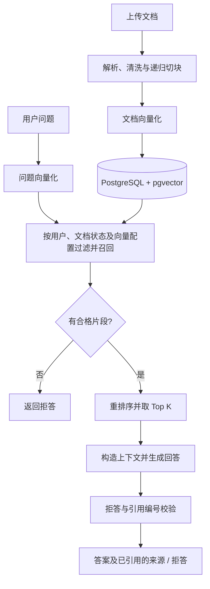

# 知屿 · 个人知识库问答

基于 **Vue 3 + Django REST Framework + LangChain + 千问 + PostgreSQL/pgvector** 的个人知识库应用。上传文档后，系统会解析文本、切分片段并建立向量索引；提问时检索当前用户的资料，通过重排序筛选上下文，再生成带有来源引用的回答。

当前运行方式为：**Docker 启动数据库，前端和后端在本地运行，模型通过云端 API 调用**。

## 功能与边界

- **账号与资料隔离**：支持注册、登录、JWT 自动刷新和退出登录；文档列表、删除与检索均按当前用户过滤。
- **文档管理**：支持上传、拖放和删除 PDF、DOCX、TXT、Markdown 文件，展示处理状态、片段数量和失败原因。默认单文件上限为 20 MB，提取文本上限为 100 万字符。
- **检索增强问答**：先通过 pgvector 召回相关片段，再使用千问重排序模型筛选上下文；只检索当前用户处于 `ready` 状态且向量模型、维度与配置一致的文档片段。
- **答案溯源**：答案使用 `[资料1]` 等编号引用来源，页面可展开查看文件名、原文片段和排序分。没有合格片段、模型拒答、缺少引用或引用编号越界时，返回“知识库未包含该信息。”
- **维护工具**：提供模型连通性检查和文档重新索引命令。

上传与索引在同一个请求中同步完成；问答一次返回完整答案。当前每次提问独立检索，不携带先前对话，聊天记录仅保存在当前页面状态中，刷新后清空。扫描版 PDF 需要先进行 OCR，项目尚未集成 OCR。

引用编号校验不能保证每个事实都受到原文支持，使用时仍需核对来源。页面中的排序分表示重排序相关性，不代表答案正确率。

## 技术栈与处理流程

| 层次 | 当前实现 |
| --- | --- |
| 前端 | Vue 3、Vue Router、Vite，使用 Fetch 请求后端 |
| 后端 | Django 5.2、Django REST Framework、Simple JWT |
| 数据存储 | PostgreSQL 16 + pgvector；上传源文件存放于本地文件系统 |
| 文档解析 | `pypdf`、`python-docx`、文本编码识别 |
| 文本切分 | LangChain `RecursiveCharacterTextSplitter`，包含中文标点分隔符 |
| 检索与生成 | 自定义 `BaseRetriever`、`Embeddings`、`BaseChatModel`，通过 HTTPX 调用 DashScope 原生接口 |

仓库默认模型如下，具体名称和服务地址需与实际使用的 API 服务匹配：

| 用途 | 配置项 | 仓库默认值 |
| --- | --- | --- |
| 答案生成 | `QWEN_CHAT_MODEL` | `qwen3.8-flash` |
| 文档及问题向量化 | `QWEN_EMBED_MODEL` | `qwen3.7-text-embedding-flash` |
| 候选片段重排序 | `QWEN_RERANK_MODEL` | `qwen3.7-text-rerank` |



默认召回最多 20 个候选片段，经重排序取前 5 个生成回答。召回使用余弦相似度阈值；重排序失败会返回错误，不会跳过该步骤继续生成。

**数据存储与传输**：用户、文档记录、文本片段和向量保存在数据库中，原始文件保存在 `backend/media/`。文档文本、问题与检索片段会发送到配置的模型服务。API Key 仅由后端读取，不放入前端。

## 项目结构

```text
.
├── .env.example                 # 环境变量模板
├── docker-compose.yml           # PostgreSQL + pgvector，仅包含 db 服务
├── backend/
│   ├── manage.py                # Django 管理入口
│   ├── requirements.txt         # 后端依赖
│   ├── config/                  # 设置、根路由与服务入口
│   ├── knowledge/
│   │   ├── models.py            # 文档与向量片段
│   │   ├── serializers.py       # 请求校验与响应序列化
│   │   ├── views.py             # 认证、文档管理与问答 API
│   │   ├── services/            # 解析、切块、索引、检索及模型适配
│   │   ├── management/commands/ # 模型检查、重新索引
│   │   ├── migrations/          # 数据库迁移
│   │   └── tests/               # 后端测试
│   └── media/                   # 上传后生成，本地保存源文件
├── frontend/
│   ├── package.json
│   ├── package-lock.json
│   ├── vite.config.js           # 开发端口与 API 代理
│   └── src/                     # 登录、注册、知识库问答界面
└── docs/
    └── LANGCHAIN_CHANGES.md      # LangChain 适配说明
```

## 本地启动

准备 Python 3.11+、Node.js 22.12+、npm，以及已启动的 Docker Desktop（Linux 容器模式，包含 Docker Compose）。以下命令使用 **Windows PowerShell**；除明确执行 `cd` 外，各步骤均从仓库根目录开始。

### 1. 配置环境变量

```powershell
if (-not (Test-Path .env)) { Copy-Item .env.example .env }
notepad .env
```

至少填写 `DASHSCOPE_API_KEY`，并核对 `DASHSCOPE_BASE_URL` 与三个模型名称。模板中的模型配置为：

```dotenv
DASHSCOPE_API_KEY=替换为你的API_Key
DASHSCOPE_BASE_URL=https://maas.qianwenaiapi.com/api/v1
QWEN_CHAT_MODEL=qwen3.8-flash
QWEN_EMBED_MODEL=qwen3.7-text-embedding-flash
QWEN_RERANK_MODEL=qwen3.7-text-rerank
EMBEDDING_DIMENSION=1024
```

后端自动加载仓库根目录的 `.env`。当前适配器使用 DashScope 原生请求和响应格式，聊天接口采用 `MultiModalConversation` 的文本消息格式；仅替换为 OpenAI 兼容地址无法直接复用。Base URL 后不要追加具体模型接口路径。

`.env` 已被 Git 忽略；完整配置项见 [环境变量模板](.env.example)。

### 2. 启动数据库

在仓库根目录执行：

```powershell
docker compose up -d --wait db
docker compose ps
```

默认连接参数如下，Django 与 Compose 必须使用一致的数据库名、用户名和密码。

| 参数 | 默认值 |
| --- | --- |
| 数据库 | `rag_knowledge_langchain` |
| 用户 / 密码 | `rag_user` / `rag_password` |
| 本机地址 | `localhost:5434` |
| 容器内部端口 | `5432` |

数据库端口仅绑定本机 `127.0.0.1`，数据保存在 Compose 的 `postgres_data` 命名卷中。

### 3. 启动后端

打开一个终端，从仓库根目录执行：

```powershell
cd backend
if (-not (Test-Path .venv\Scripts\python.exe)) { python -m venv .venv }
.\.venv\Scripts\python.exe -m pip install -r requirements.txt
.\.venv\Scripts\python.exe manage.py migrate
.\.venv\Scripts\python.exe manage.py runserver 127.0.0.1:8000
```

直接使用虚拟环境中的 Python，无需执行激活脚本。迁移会创建业务表并启用 pgvector 扩展。

### 4. 启动前端

另开一个终端，从仓库根目录执行：

```powershell
cd frontend
npm.cmd ci
npm.cmd run dev
```

访问 [http://localhost:5174](http://localhost:5174)，注册账号、上传文档，待文档显示可用后即可提问。

当前端口对应关系为：

| 服务 | 地址 / 行为 |
| --- | --- |
| 前端 | `http://localhost:5174`，端口占用时直接报错 |
| Django 后端 | `http://127.0.0.1:8000` |
| 前端 API 请求 | 默认使用 `/api`，由 Vite 转发到 `http://127.0.0.1:8000` |
| PostgreSQL | `localhost:5434` |

修改后端端口时，同步修改 [Vite 代理配置](frontend/vite.config.js)；修改前端访问地址时，核对 `CORS_ALLOWED_ORIGINS`。前端也支持通过 `frontend/.env.local` 中的 `VITE_API_BASE_URL` 指定 API 前缀，例如 `http://127.0.0.1:8000/api`，修改后重启 Vite。

macOS / Linux 可使用相同流程，将虚拟环境的 Python 路径替换为 `.venv/bin/python`，将 `npm.cmd` 替换为 `npm`，并使用对应 Shell 的环境变量语法。

### 5. 停止与再次启动

前后端分别按 `Ctrl+C` 停止；在仓库根目录执行 `docker compose stop db` 停止数据库。下次启动数据库后，重新执行后端 `runserver` 和前端 `npm.cmd run dev` 即可，无需重复安装依赖或重新索引。

`docker compose down -v` 会删除数据库卷；保留资料时不要使用该命令。备份项目数据需要同时保留数据库和 `backend/media/` 源文件。

## 常用配置

下表列出仓库默认值，实际配置以根目录 `.env` 和进程环境变量为准。后端配置实现在 [settings.py](backend/config/settings.py)。

| 配置项 | 默认值 | 说明 |
| --- | --- | --- |
| `DASHSCOPE_API_KEY` | 空 | 必填，模型服务凭据 |
| `DASHSCOPE_BASE_URL` | `https://maas.qianwenaiapi.com/api/v1` | 三个模型共用的原生 API Base URL |
| `QWEN_TIMEOUT` | `120` | 单次模型请求超时，单位为秒 |
| `QWEN_TRUST_ENV` | `false` | 默认直连；设为 `true` 时读取代理及 CA 环境变量，HTTPS 证书校验保持开启 |
| `QWEN_MAX_TOKENS` | `700` | 回答输出 Token 上限；当前关闭思考模式 |
| `EMBEDDING_DIMENSION` | `1024` | 必须与数据库向量字段维度一致 |
| `RAG_RETRIEVAL_K` | `20` | 向量召回数，实际取值至少为 `RAG_TOP_K` |
| `RAG_TOP_K` | `5` | 重排序后用于回答的最大片段数 |
| `RAG_MIN_SIMILARITY` | `0.45` | 向量召回的最低余弦相似度 |
| `RAG_CHUNK_SIZE` | `800` | 文本块最大字符数 |
| `RAG_CHUNK_OVERLAP` | `120` | 目标重叠字符数，必须小于块大小 |
| `MAX_UPLOAD_SIZE_MB` | `20` | 后端单文件上传上限；前端提示文案当前固定为 20 MB |
| `MAX_EXTRACTED_CHARS` | `1000000` | 单文档提取文本字符上限 |
| `POSTGRES_PORT` | `5434` | 本地后端连接数据库的端口 |
| `POSTGRES_HOST_PORT` | `5434` | Compose 映射到本机的数据库端口，变更时同步修改 `POSTGRES_PORT` |

`.env.example` 还提供 Django 主机、跨域及 HTTPS 相关配置。当前启动命令面向本地开发；部署时需配置独立的服务进程、静态资源与 API 转发，并调整密钥、`DJANGO_DEBUG` 和 HTTPS 设置。Vite 的开发代理不会包含在前端构建产物中。

## 模型检查与重新索引

以下命令均在 `backend/` 目录执行。

### 检查模型接口

```powershell
.\.venv\Scripts\python.exe manage.py check_qwen
```

命令使用固定测试文本依次检查文档向量、查询向量、重排序和聊天接口，并校验返回的向量维度。它不读取用户文档、不连接数据库，但会真实调用模型并产生 API 用量。

### 重建文档向量

切换向量模型、调整切块参数或修复失败文档后，可以从已保存的源文件重新索引：

```powershell
# 重建全部文档
.\.venv\Scripts\python.exe manage.py reindex_documents

# 仅重建指定用户的文档
.\.venv\Scripts\python.exe manage.py reindex_documents --user-id 1
```

命令保留用户、文档记录与源文件，成功后替换片段及向量，会产生向量 API 用量。源文件必须仍在 `backend/media/`；失败文档会标记为 `failed` 并记录原因，修复后可再次执行。重建期间建议暂停上传与问答。

不同模型的向量即使维度相同也不能混用。当前检索会排除未标记模型信息、模型不匹配或维度不匹配的旧片段；从旧向量模型迁移时需要重新索引。现有迁移将向量字段固定为 **1024 维**，更改维度必须配套数据库迁移与重新索引，不能仅修改 `.env`。

## API 概览

接口统一位于 `/api/`，使用带尾斜杠的路径。除注册、登录和刷新接口外，均需请求头 `Authorization: Bearer <access_token>`。

| 方法 | 路径 | 用途 / 请求数据 |
| --- | --- | --- |
| `POST` | `/api/auth/register/` | 注册：`username`、`email`、`password`、`password_confirm` |
| `POST` | `/api/auth/login/` | 登录：`username`、`password` |
| `POST` | `/api/auth/refresh/` | 刷新令牌：`refresh` |
| `POST` | `/api/auth/logout/` | 将提交的 `refresh` 令牌加入黑名单 |
| `GET` | `/api/auth/me/` | 获取当前用户 |
| `GET` | `/api/documents/` | 获取当前用户的文档列表 |
| `POST` | `/api/documents/` | 上传文件：`multipart/form-data`，字段名 `file` |
| `DELETE` | `/api/documents/<id>/` | 删除当前用户的文档、全部片段及源文件 |
| `POST` | `/api/ask/` | 提问：`{"question": "你的问题"}`，最多 2000 字符 |

注册和登录返回用户信息及 `access` / `refresh` 令牌。访问令牌默认有效期为 30 分钟，刷新令牌为 7 天；刷新时会轮换令牌并使旧刷新令牌失效。

问答返回 `answer`、`sources`、`refused`。每条来源包含资料编号 `index`、文档 ID / 名称、片段索引、`similarity`、`rerank_score` 和最多 800 字符的 `excerpt`；仅返回答案实际引用的来源。拒答时 `refused` 为 `true`，`sources` 为空。

文档状态包括 `processing`、`ready` 和 `failed`。解析或索引失败会保留文档记录及源文件，可从列表的 `error_message` 查看原因；相应上传请求返回 HTTP 502，模型服务错误也会转换为 HTTP 502。

## 测试与构建

### 后端测试

在 `backend/` 下使用 SQLite 执行现有测试，无需启动 PostgreSQL，也不会调用真实模型服务：

```powershell
$previousEngine = $env:DATABASE_ENGINE
try {
    $env:DATABASE_ENGINE = 'sqlite'
    .\.venv\Scripts\python.exe manage.py test knowledge.tests
} finally {
    $env:DATABASE_ENGINE = $previousEngine
}
```

测试覆盖认证、用户隔离、上传失败与事务回滚、切块、模型请求格式、向量校验、重排序、引用校验及重新索引。SQLite 仅用于单元测试，会跳过真实 pgvector 检索测试。

验证 PostgreSQL/pgvector 时，先启动数据库，并确保 `DATABASE_ENGINE` 未设为 `sqlite`，再执行：

```powershell
.\.venv\Scripts\python.exe manage.py test knowledge.tests
```

Django 会创建并销毁独立测试数据库，连接用户需有建库权限；此模式会额外验证真实向量距离计算与数据库过滤。真实云端接口可用性由 `check_qwen` 单独检查。

### 前端构建

在 `frontend/` 下执行：

```powershell
npm.cmd run build
```

构建产物位于 `frontend/dist/`。当前 `package.json` 提供 `dev`、`build`、`preview` 三个脚本，尚未配置前端自动化测试。

## 常见问题

| 现象 | 排查方向 |
| --- | --- |
| Docker 无法连接 | 启动 Docker Desktop，确认引擎就绪且 `docker info` 可返回服务端信息 |
| 数据库连接失败 | 检查 `docker compose ps` 的健康状态，以及 `.env` 的数据库连接信息；本地后端使用 `localhost:5434` |
| 前端请求失败 / 代理报错 | 确认 Django 运行于 `127.0.0.1:8000`，与 Vite `/api` 代理目标一致 |
| 数据库或前端端口占用 | 数据库同步调整 `POSTGRES_HOST_PORT` / `POSTGRES_PORT`；前端调整 Vite 端口及跨域配置 |
| 模型 HTTP 400 / 404 | 核对原生 Base URL、模型名称和服务支持的请求格式 |
| 模型 HTTP 401 / 403 / 429 | 核对 API Key、地域 / 业务空间、模型权限、额度与限流情况 |
| 模型连接失败或超时 | 运行 `check_qwen` 检查；默认直连，网络需要代理或自定义 CA 时再设置 `QWEN_TRUST_ENV=true` |
| 上传后显示失败 | 查看文档错误信息，检查格式、文本是否可提取、字符上限及向量服务配置；扫描 PDF 先进行 OCR |
| 有文档却一直拒答 | 确认文档状态为 `ready` 且已使用当前模型索引；用原文明确包含的事实提问，再评估相似度阈值是否合适 |
| 修改密码后数据库认证失败 | 已有卷保留初始化时的密码；修改 `.env` 不会同步修改数据库用户密码，需使用原密码连接后修改数据库用户 |

更多实现细节见 [LangChain 适配说明](docs/LANGCHAIN_CHANGES.md)。
