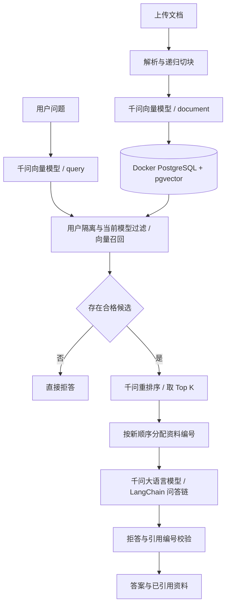

# LangChain 千问版改造说明

`langlain/` 是独立的 LangChain 版本。运行方式为 Docker PostgreSQL + pgvector、本地 Django、本地 Vue；完整步骤见 [README](../README.md)。

| 环节 | 当前实现 |
| --- | --- |
| 解析 | 原有 pypdf / python-docx / 文本解析与清洗 |
| 切块 | `RecursiveCharacterTextSplitter`，保留中文分隔符 |
| 向量 | `QwenEmbeddings(Embeddings)` 调用 `qwen3.7-text-embedding-flash`，区分 query/document |
| 初步检索 | `UserDocumentRetriever(BaseRetriever)` 按用户、ready 状态、向量模型、维度与余弦阈值过滤 |
| 重排序 | `qwen3.7-text-rerank` 从默认 20 个候选片段中选出默认前 5 个 |
| 回答 | `ChatPromptTemplate` → `QwenChatModel(BaseChatModel)` / `qwen3.8-flash` → `StrOutputParser` |
| 凭据 | 仅后端从 `.env` 的 `DASHSCOPE_API_KEY` 读取 |
| 错误处理 | 超时、鉴权失败、格式错误等统一转为 `ModelServiceError`，API 返回 502 |

对应文件：

- [`qwen.py`](../backend/knowledge/services/qwen.py)：模型适配、原生 DashScope 请求、向量数量/维度/顺序校验、重排序索引及分数校验、脱敏错误。
- [`retrieval.py`](../backend/knowledge/services/retrieval.py)：向量召回与重排序，保留两种独立分数。
- [`ingestion.py`](../backend/knowledge/services/ingestion.py)：事务写入片段，在 metadata 标记向量模型与维度。
- [`rag.py`](../backend/knowledge/services/rag.py)：使用重排序结果构造上下文与引用，保持文档花括号为字面量。
- [`check_qwen.py`](../backend/knowledge/management/commands/check_qwen.py)：无需数据库的实际模型接口检查。
- [`reindex_documents.py`](../backend/knowledge/management/commands/reindex_documents.py)：从现有源文件重建向量，保留文档身份和用户归属。

移除 `langchain-ollama`，当前使用 `langchain-core==1.6.6`、`langchain-text-splitters==1.1.2` 与 `httpx==0.28.1`。三个模型全部通过 HTTPX 调用用户示例中的 DashScope 原生接口，无需 OpenAI 或 DashScope SDK；聊天适配 `BaseChatModel`，向量适配 `Embeddings`。请求均使用 input/parameters，聊天消息 content 使用文本块数组，对应 MultiModalConversation 的数据格式。

向量返回可能乱序，兼容当前 Flash 返回的 `index` 与较早 DashScope 接口的 `text_index`，按索引恢复与原文的对应。重排序按返回的原始 index 选取候选，再按 relevance_score 排序并重编 `[资料n]`。不接受越界/重复索引或非有限分数；重排序失败不跳过该阶段。

`QWEN_TRUST_ENV=false` 默认让本项目的千问请求直连，避免继承本机代理导致 TLS 握手中断；HTTPS 证书校验保持开启。需要代理或 CA 环境变量时可设为 `true`。已用真实本地 HTTP 服务覆盖代理失败/直连成功的回归测试，并用实际 Flash 响应结构覆盖向量索引兼容测试。

模型默认非流式、关闭思考、temperature=0.1、最多 700 个输出 Token。对外 API 仍一次返回完整答案。仍有无资料、模型拒答、无引用及非法引用时的拒答约束。

数据库结构保持 1024 维，无新增迁移。旧 Ollama 向量不能复用，需要 `manage.py reindex_documents`；检索过滤会排除未标记/模型不匹配的旧向量，防止混用。对源文件缺失的文档会保留失败状态。

前端端口为 5174，后端端口为 8000，Docker 数据库绑定本机 5435；Compose 项目名为 `rag-langchain-independent`，使用独立的 `rag-langchain-independent_postgres_data` 数据卷，与旧项目的数据卷分开。Compose 仅保留 `db` 服务；前后端 Dockerfile、Nginx 配置及容器启动脚本已移除，前后端均在本地运行。

测试覆盖三个模型的 HTTP 请求格式、LangChain 链、乱序向量、批量限制、重排序索引、上下文及引用对应、错误转换、用户隔离、上传失败与事务回滚。真实 API 可用性由 `check_qwen` 验证；SQLite 单元测试无法验证 pgvector 距离运算。
